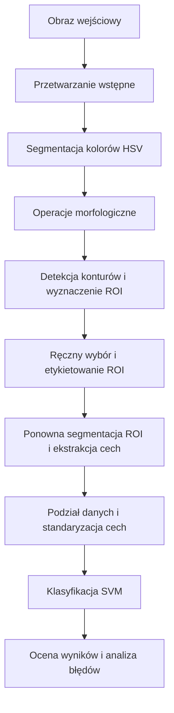
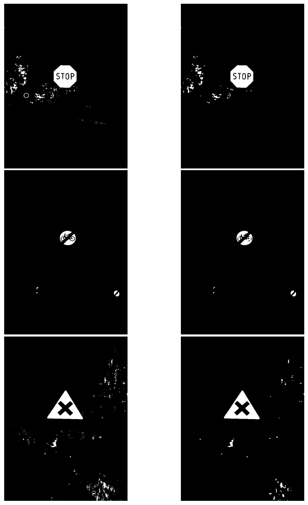
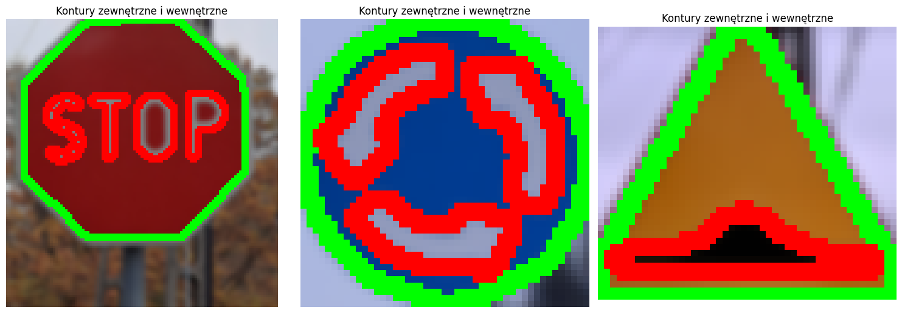

# Traffic Sign Recognition – rozpoznawanie znaków drogowych

Celem projektu jest zaprojektowanie, implementacja i przetestowanie potoku wykrywania oraz klasyfikacji znaków drogowych z wykorzystaniem klasycznych metod przetwarzania obrazu i uczenia maszynowego.

Projekt opiera się na autorskim zbiorze danych, który przygotowałem samodzielnie, fotografując znaki drogowe w naturalnych warunkach. Obejmuje cały proces eksperymentalny – od akwizycji danych i przetwarzania obrazu, przez ekstrakcję cech, aż po uczenie klasyfikatora oraz analizę wyników.

**Status projektu:** zaimplementowana wersja bazowa (etap 2); rozpoczęta analiza błędów i przygotowanie optymalizacji (etap 3).


## Zbiór danych

Podczas zbierania danych uwzględniłem zróżnicowane oświetlenie, cienie, odległości od obiektów, kąty obserwacji oraz elementy tła, które mogą utrudniać segmentację.

**[Zbiór danych – Dysk Google](https://drive.google.com/drive/folders/1qgMNpPgJHUDNbFQr3L3fJr9prOsZ97U5?usp=drive_link)**

Zdjęcia są uporządkowane w trzech katalogach: `zakazu`, `nakazu` i `ostrzegawcze`. W aktualnej wersji klasyfikator rozróżnia trzy konkretne znaki oraz dodatkową klasę innych znaków:

| Etykieta | Znaczenie |
| --- | --- |
| B-20 | STOP |
| C-12 | Ruch okrężny |
| A-5 | Skrzyżowanie dróg |
| Inny znak | Pozostałe oznakowane znaki |


## Wykorzystane technologie

| Technologia | Zastosowanie |
| --- | --- |
| Python | Implementacja potoku przetwarzania i klasyfikacji |
| OpenCV | Przetwarzanie obrazu, segmentacja, morfologia i analiza konturów |
| NumPy, pandas | Obliczenia numeryczne i przygotowanie danych |
| scikit-learn | Standaryzacja cech, klasyfikacja SVM i ocena modelu |
| Matplotlib | Wizualizacja wyników |
| Jupyter Notebook / Google Colab | Środowisko realizacji eksperymentów |

## Potok przetwarzania obrazu



### 1. Przetwarzanie wstępne

- Proporcjonalne skalowanie obrazów do maksymalnego wymiaru 800 pikseli.
- Redukcja szumów za pomocą filtru Gaussa.
- Warunkowa korekcja kontrastu metodą CLAHE w kanale jasności przestrzeni Lab.

### 2. Segmentacja i detekcja ROI

Po konwersji obrazu do przestrzeni HSV tworzone są maski kolorów czerwonego, niebieskiego i żółtego. Maski są oczyszczane za pomocą otwarcia i zamknięcia morfologicznego. Następnie wykrywane są kontury zewnętrzne, filtrowane według pola powierzchni, i wyznaczane prostokątne obszary zainteresowania (ROI).

W aktualnej wersji wybór poprawnych ROI i przypisanie im etykiet odbywa się ręcznie. Wybrane fragmenty poddawane są ponownej segmentacji oraz analizie konturów zewnętrznych i wewnętrznych.




Kolorem zielonym zaznaczono główny kontur zewnętrzny,
natomiast kolorem czerwonym kontury wewnętrzne.

Uwzględnienie konturów wewnętrznych umożliwia
rozróżnianie znaków o podobnym kształcie zewnętrznym
i kolorystyce, lecz różniących się symbolem wewnętrznym.



### 3. Ekstrakcja cech

Każdy poprawnie przetworzony ROI opisuje wektor **30 cech** obejmujący:

| Grupa cech | Przykłady |
| --- | --- |
| Geometryczne | Pola i obwody konturów, ich proporcje, zwartość, prostokątność, smukłość, współczynnik Malinowskiej |
| Momentowe | Niezmienniki momentowe Hu konturu zewnętrznego i największego konturu wewnętrznego po transformacji logarytmicznej |
| Topologiczne | Liczba Eulera i liczba konturów wewnętrznych |
| Barwne | Średnie i wariancje kanałów H i S przestrzeni HSV |

### 4. Klasyfikacja

Dane dzielone są na zbiór treningowy i testowy w proporcji 80:20 z zachowaniem proporcji klas. Cechy są standaryzowane za pomocą `StandardScaler` dopasowanego wyłącznie do zbioru treningowego. Następnie uczony jest klasyfikator SVM z jądrem RBF.

## Wyniki wersji bazowej

W notebooku zaraportowano następujące wyniki klasyfikacji:

| Metryka | Wynik |
| --- | ---: |
| Accuracy – zbiór treningowy | 97,79% |
| Accuracy – zbiór testowy | 100% |
| Precision (macro) | 1,00 |
| Recall (macro) | 1,00 |
| F1-score (macro) | 1,00 |
| Liczba próbek testowych | 35 ROI |


Wyniki są wstępne i dotyczą klasyfikacji ręcznie wybranych ROI, a nie skuteczności całego procesu wykrywania znaków na zdjęciach. Przypadki nieudanej segmentacji były odrzucane. Niewielka liczebność zbioru testowego ogranicza możliwość oceny generalizacji modelu. 

## Analiza błędów i ograniczenia

Podczas testowania wersji bazowej zidentyfikowałem następujące problemy:

- Trudności w segmentacji znaków na tle o zbliżonej barwie.
- Łączenie znaków z tłem podczas zamknięcia morfologicznego, szczególnie w przypadku znaków ostrzegawczych.
- Pomijanie niewielkich znaków lub wykrywanie jedynie fragmentów obiektu.
- Wpływ elementów tła w ROI na wyznaczane cechy, m.in. liczbę Eulera.


## Dalszy rozwój – etap 3

- [ ] Poprawa segmentacji i adaptacyjny dobór parametrów operacji morfologicznych.
- [ ] Przygotowanie masek wzorcowych (ground truth) dla 10 zdjęć i porównanie jakości segmentacji za pomocą IoU.
- [ ] Analiza korelacji, selekcja cech i poprawa sposobu ich wyznaczania.
- [ ] Strojenie hiperparametrów SVM z wykorzystaniem Grid Search i walidacji krzyżowej.
- [ ] Porównanie wersji bazowej z wersją zoptymalizowaną oraz ocena skuteczności całego potoku.

## Uruchomienie projektu

Notebooki znajdują się w katalogu [`notebooks/`](notebooks/). Aktualna implementacja jest przygotowana do pracy w Google Colab.

1. Pobierz oryginalny zbiór zdjęć z [Dysku Google](https://drive.google.com/drive/folders/1qgMNpPgJHUDNbFQr3L3fJr9prOsZ97U5?usp=drive_link) i umieść go na swoim Dysku Google, zachowując nazwy plików oraz podkatalogi `zakazu`, `nakazu`, `ostrzegawcze`.
2. Otwórz aktualny notebook (`etap_3.ipynb`) w Google Colab i zamontuj Dysk Google.
3. Dostosuj zmienną `DATA_DIR` do lokalizacji folderu ze zdjęciami.
4. Uruchamiaj komórki kolejno od początku notebooka.

Jeśli wymagane biblioteki nie są dostępne w środowisku, zainstaluj je poleceniem:

```bash
pip install opencv-python numpy pandas matplotlib scikit-learn
```

**Uwaga:** etykiety w obecnej implementacji odwołują się do indeksów zdjęć i ROI, dlatego odtworzenie eksperymentu wymaga zachowania oryginalnego zbioru danych i kolejności wczytywania plików. Projekt nie jest jeszcze w pełni automatycznym narzędziem do rozpoznawania znaków na dowolnym zdjęciu.
